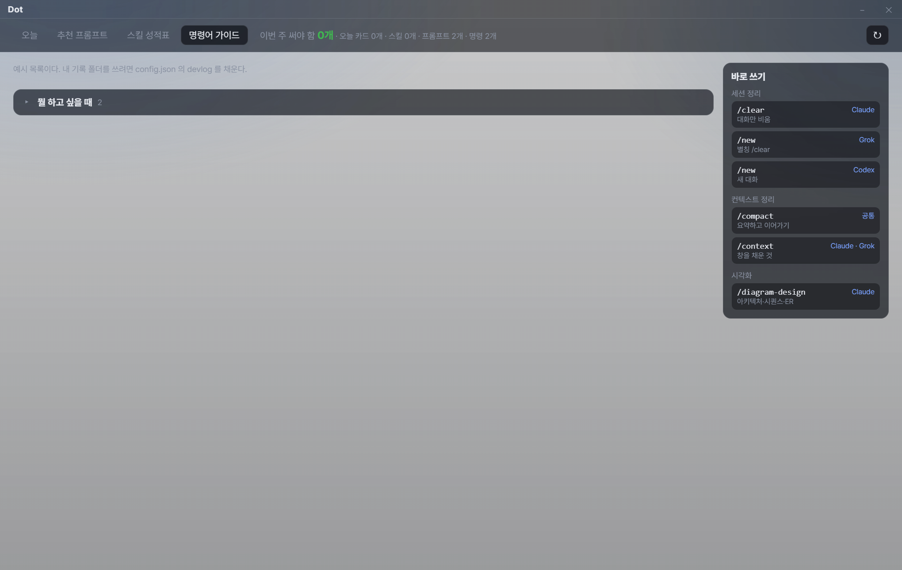
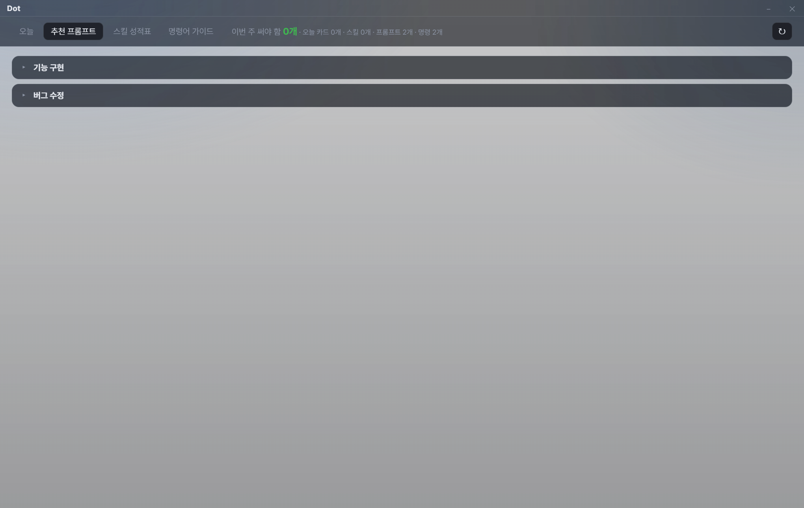

# Dot

오늘 카드, 추천 프롬프트, 스킬 성적표, 명령어 가이드를 보여주는 로컬 대시보드.

저장소에는 예시 데이터만 있다. 개인 기록 폴더와 절대 경로는 포함하지 않는다.

## 다른 기기에서

```
npm install
npm start
```

예시 화면으로 켜진다. 아래 그림은 저장소의 샘플 데이터로 켠 모습이다.

명령어 가이드. 오른쪽에서 자주 쓰는 명령을 복사하고, 나머지 목록은 접혀 있다.



추천 프롬프트. 제목을 누르면 본문이 열린다.



내 기록을 보려면 `config.example.json`을 `config.json`으로 복사하고 `devlog`에 기록 폴더 경로를 넣는다. `skillsRoot`는 설치된 스킬 폴더다. 비우면 예시만 본다.

`config.json`은 저장소에 올리지 않는다.
